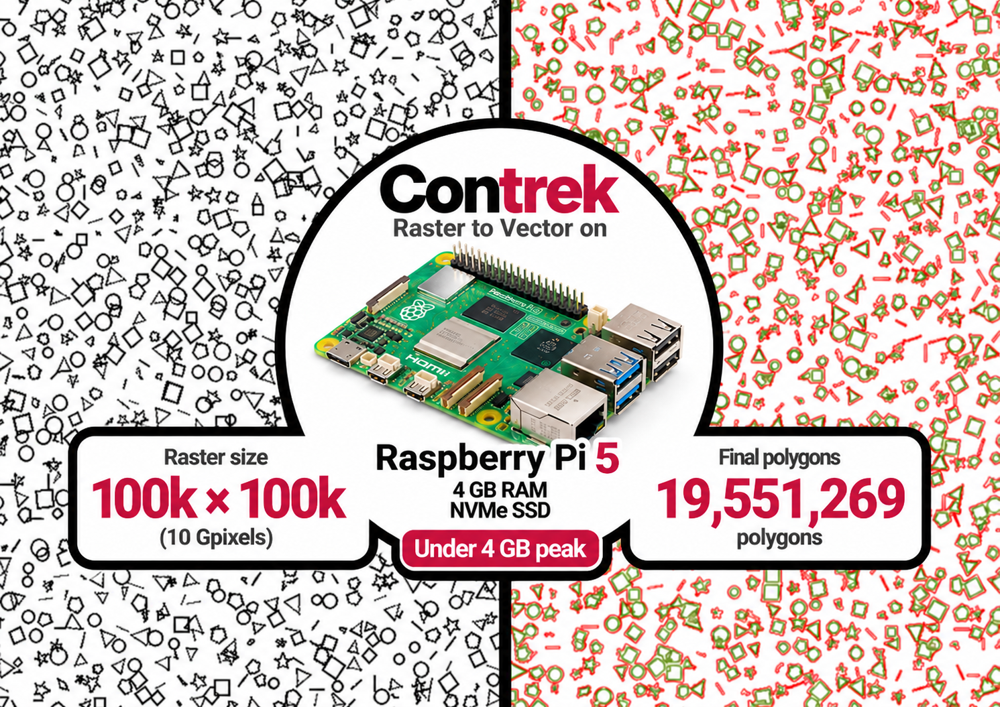

# Contrek C++ on Raspberry Pi 5 Progressive Streaming Benchmark

This benchmark demonstrates the efficiency of Contrek’s streaming polygonization algorithm by processing a massive raster image end-to-end on a Raspberry Pi 5 with just 4 GB of RAM.

The test processes a 100,000 × 100,000 PNG image (10 billion pixels), progressively reconstructs polygons across overlapping horizontal stripes, and writes completed geometries directly to an SVG file. The goal is to verify that a raster much larger than available memory can be processed without retaining the full raster or the complete vector output in 
RAM.



## How it works

The pipeline is:

1. Progressive PNG decoding — only the current portion of the raster is decoded into memory.
2. Stripe polygon extraction — Contrek traces polygons within horizontal stripes of 1,000 pixels.
3. Topological streaming merge — contours crossing adjacent stripe boundaries are reconnected.
4. Progressive SVG output — completed geometries are written to disk rather than accumulated in memory.

Memory requirements are therefore driven primarily by the active raster stripe and unfinished geometries, not by the total raster or output file size.

## Build and Launch via Docker

Build the test environment and enter the container shell from the repository root:


```bash
sudo docker compose build test
sudo docker compose run test
```


## Input image

The benchmark uses:

```text
File:        test_100k.png
Resolution:  100,000 × 100,000
Pixels:      10,000,000,000
File size:   900,175,425 bytes
```

Download the file into the repository's `images` directory by running:

```bash
sudo docker compose run test
./scripts/download_heavy_asset.sh
```

Verify the file size:

```bash
stat -c '%s' images/test_100k.png
# 900175425
```

## Visual demonstration

The image contains millions of polygons. You can see here a 2,000 × 2,000 pixel crop extracted from the original 100,000 × 100,000 pixel raster:

[2,000 × 2,000 pixel crop](images/clip_2000.png)

The crop can be reproduced using libvips:

```bash
vips extract_area ../../images/test_100k.png clip_2000.png 43700 28600 2000 2000
```

The extraction starts at coordinates `(43700, 28600)` and produces a 2,000 × 2,000 pixel image without decoding the entire raster into memory.


## Running the benchmark

From inside the Docker container running on your Pi5

```Bash
cd test
./cpp_test.sh
cd build
set -o pipefail

/usr/bin/time -v -o benchmark_memory.txt \
  ./progressive_streaming_benchmark \
  --image ../../images/test_100k.png \
  --stripe-height 1000 \
  2>&1 | tee benchmark_output.log
```

The command writes:

- `benchmark_output.log` — Contrek's progress and final statistics.
- `benchmark_memory.txt` — elapsed time, peak resident memory, CPU usage and other measurements reported by GNU `time`.
- `streaming_buffer.svg` — the generated vector output.


## Current benchmark results

The following results were obtained on a Raspberry Pi 5, running the native C++ benchmark inside a Docker container:

```text
Machine:             Raspberry Pi 5
RAM:                 4 GB
Architecture:        ARM64
Storage:             250 GB NVMe SSD
Environment:         Docker / Ubuntu 24.04
Input image:         test_100k.png
Resolution:          100,000 × 100,000
Pixels:              10,000,000,000
Stripe height:       1,000
Processed stripes:   101 (indices 0–100)
Polygons reported:   19,551,269
Execution time:      832.081 s (13 min 52 s)
Peak RSS:            2,540,480 KiB (2.42 GiB)
SVG output size:     21,031,040,705 bytes (19.59 GiB)
Exit status:         0
```

The GNU `time` report was:

```text
User time (seconds): 822.53
System time (seconds): 9.33
Percent of CPU this job got: 99%
Elapsed (wall clock) time (h:mm:ss or m:ss): 13:52.13
Maximum resident set size (kbytes): 2540480
Major (requiring I/O) page faults: 7
Minor (reclaiming a frame) page faults: 170133
Swaps: 0
Exit status: 0
```

During the run, the Pi5 CPU temperature was observed at **53.2°C**. Approximately 800–900 MB of the 4 GB RAM remained available throughout the benchmark, confirming that the system maintained a comfortable memory margin even while processing the 10-gigapixel raster.
